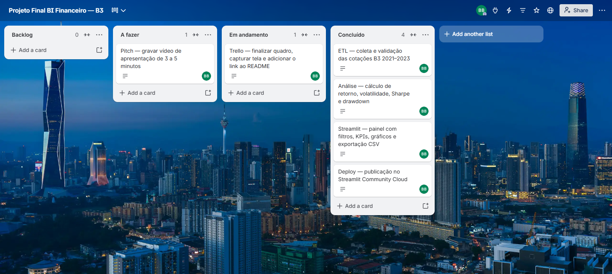

# Carteira em Foco — Análise de ações da B3

## 1. Resumo executivo

**Carteira em Foco** é um painel de Business Intelligence para acompanhar o desempenho, o risco e a evolução de 12 ações negociadas na B3 entre 2021 e 2023. O projeto transforma séries históricas de preços em indicadores e visualizações para apoiar uma leitura comparativa da carteira.

A aplicação permite filtrar ativos, grupos setoriais e datas; comparar retornos normalizados e anuais; observar risco e drawdown; analisar correlações entre retornos diários; e exportar a base filtrada.

> Projeto acadêmico individual da Linha 2 — Performance de Mercado de Ações e Séries Temporais.

## 2. Contexto de negócio e pergunta orientadora

Um investidor ou analista precisa comparar ativos com preços, riscos e trajetórias diferentes. O painel responde à pergunta:

**Como os 12 ativos selecionados se comportaram em retorno e risco entre 2021 e 2023, e quais diferenças aparecem entre os grupos setoriais definidos para esta análise?**

Perguntas complementares:

- Quais ativos tiveram maior e menor retorno acumulado?
- Como variou o desempenho de cada ativo por ano?
- Quais grupos setoriais tiveram maior retorno médio anual?
- Quais ativos apresentaram maior associação linear em seus retornos diários?
- Como se comportaram a volatilidade, o drawdown e as médias móveis?

## 3. Fonte de dados, período e uso

- **Fonte consultada:** histórico público de mercado disponibilizado pelo Yahoo Finance, obtido em Python pela biblioteca `yfinance`, com símbolos de ações brasileiras.
- **Janela definida:** 01/01/2021 a 31/12/2023.
- **Pregões encontrados na base:** 04/01/2021 a 28/12/2023, correspondentes aos pregões disponíveis no intervalo.
- **Universo:** ABEV3, BBDC4, EGIE3, EMBR3, GGBR4, ITUB4, KLBN11, PETR4, PRIO3, RENT3, VALE3 e WEGE3.
- **Volume da base:** 745 observações por ativo, totalizando 8.940 linhas na série consolidada.
- **Arquivos principais:** `data/precos_acoes_2021_2023.csv` e `data/indicadores_diarios_2021_2023.csv`.

A fonte utilizada é uma API pública de cotações, conforme permitido para a Linha 2 no enunciado. Ela não é apresentada como uma extração direta dos arquivos oficiais da B3. Consulte os termos aplicáveis da fonte antes de reutilizar ou redistribuir os dados.

**Observação sobre o ticker EMBR3:** a identificação do ativo pode diferir na fonte de cotações em razão de mudanças de símbolo. O pipeline padroniza o nome exibido no recorte histórico como `EMBR3`; essa regra deve ser mantida documentada junto à extração.

## 4. Pipeline de engenharia de dados

O script `etl.py` realiza a extração e preparação da série histórica. O fluxo geral é:

1. Consulta os dados históricos dos ativos por meio de `yfinance`.
2. Padroniza os campos de preço, volume, data e ticker.
3. Converte datas para tipo datetime e campos financeiros para tipos numéricos.
4. Remove registros inválidos e duplicados por data e ativo.
5. Ordena a base por ativo e data e verifica cobertura, nulos e duplicatas.
6. Calcula indicadores derivados e grava os arquivos CSV na pasta `data/` usando caminhos relativos ao projeto.

A aplicação carrega a tabela por conexão PostgreSQL, se configurada, e utiliza o CSV versionado como contingência. O carregamento é armazenado em cache por uma hora com `st.cache_data`.

## 5. Dicionário de dados

| Campo | Tipo | Significado e regra aplicada |
|---|---|---|
| `data` | datetime | Data do pregão. Convertida para data/hora durante a leitura. |
| `abertura` | float | Preço de abertura do ativo no pregão, em reais. |
| `maxima` | float | Maior preço registrado no pregão, em reais. |
| `minima` | float | Menor preço registrado no pregão, em reais. |
| `fechamento` | float | Preço de fechamento não ajustado, em reais. |
| `fechamento_ajustado` | float | Fechamento ajustado conforme a série da fonte; usado nas análises de retorno. |
| `volume_acoes` | int/float | Quantidade de ações negociadas no pregão, conforme a fonte. |
| `ticker` | string | Código padronizado do ativo, por exemplo `PETR4`. |
| `volume_financeiro_estimado` | float | Estimativa calculada por fechamento × volume de ações. Não equivale ao financeiro oficial do pregão. |
| `retorno_diario` | float | Variação percentual diária calculada sobre o fechamento ajustado: preço ajustado atual ÷ preço ajustado anterior − 1. |
| `base_100` | float | Série normalizada a partir do primeiro preço de referência; no painel, a visualização é rebaseada ao primeiro pregão do período filtrado. |
| `sma_21` | float | Média móvel simples de 21 pregões do preço ajustado. |
| `sma_50` | float | Média móvel simples de 50 pregões do preço ajustado. |
| `pico_historico` | float | Maior fechamento ajustado acumulado até a data. |
| `drawdown` | float | Variação em relação ao pico histórico: fechamento ajustado ÷ pico histórico − 1. Valores negativos representam quedas do pico. |

### Indicadores derivados na aplicação

- **Retorno acumulado no período:** preço ajustado final ÷ preço ajustado inicial − 1.
- **Volatilidade anualizada:** desvio-padrão dos retornos diários × √252.
- **Sharpe empírico:** retorno médio diário ÷ desvio-padrão diário × √252, assumindo taxa livre de risco igual a zero.
- **Retorno anual por ativo:** variação entre o primeiro e o último pregão disponível daquele ano no intervalo filtrado.
- **Retorno setorial:** média simples dos retornos anuais dos ativos disponíveis em cada grupo do projeto.
- **Correlação:** coeficiente de Pearson entre retornos diários, não entre níveis de preço.

## 6. Grupos setoriais adotados

Para facilitar a comparação no painel, os ativos foram organizados em cinco **grupos analíticos do projeto**:

| Grupo | Ativos |
|---|---|
| Consumo e serviços | ABEV3, RENT3 |
| Indústria | EMBR3, WEGE3 |
| Commodities | GGBR4, KLBN11, VALE3 |
| Energia | PETR4, PRIO3, EGIE3 |
| Financeiro | BBDC4, ITUB4 |

Esses grupos são uma simplificação para a visualização e não devem ser interpretados como uma classificação oficial da B3. Os grupos também têm quantidades diferentes de ativos; por isso, o retorno do grupo é uma média simples e não uma carteira setorial ponderada por valor de mercado.

## 7. Tecnologias

| Tecnologia | Uso no projeto |
|---|---|
| Python | Linguagem do pipeline e da aplicação. |
| Pandas | Tratamento, organização e cálculo sobre séries temporais. |
| yfinance | Obtenção do histórico de cotações para os símbolos selecionados. |
| Streamlit | Aplicação interativa, filtros, KPIs, abas e exportação. |
| Plotly Express | Gráficos interativos. |
| PostgreSQL / SQLAlchemy | Conexão opcional à base na nuvem; a aplicação prevê fallback para CSV. |
| Git e GitHub | Versionamento e organização do desenvolvimento por branches e pull requests. |

## 8. Resultados observados

Na base consolidada de 2021–2023 e com pesos iguais para os 12 ativos, os cálculos preliminares do pipeline apontaram:

- **Retorno médio acumulado dos ativos:** 58,41%.
- **Maior retorno acumulado:** PETR4, aproximadamente 228,69%.
- **Menor retorno acumulado:** BBDC4, aproximadamente −6,93%.
- **Volatilidade anualizada média:** 33,61%.
- **Menor drawdown máximo em magnitude entre os ativos:** EGIE3, aproximadamente −17,65%.

Os resultados são descritivos e dependem do intervalo, da fonte e das regras de cálculo adotadas. O Sharpe usa taxa livre de risco igual a zero. Não se infere causalidade a partir de correlações ou de desempenho passado.

> Atualize estes números se uma nova execução do ETL alterar a base ou os resultados.

## 9. Limitações da análise

- A janela cobre três anos e não representa todos os ciclos de mercado.
- A fonte é uma base pública consolidada de cotações; diferenças de cobertura, ajustes e disponibilidade podem ocorrer.
- O volume financeiro foi estimado por fechamento × quantidade de ações e não representa o valor oficial negociado.
- O Sharpe considera taxa livre de risco igual a zero, simplificação que pode alterar a comparação de risco-retorno.
- A média simples dá o mesmo peso a cada ativo e não reproduz necessariamente a composição de uma carteira real.
- Os grupos setoriais são simplificações do projeto e contêm quantidades diferentes de ativos.
- Correlação linear mede associação histórica entre retornos e não comprova causalidade nem garante comportamento futuro.
- O retorno anual apresentado usa primeiro e último pregão disponível dentro do ano e do período selecionado; filtros de datas podem produzir anos parciais.

## 10. Aplicação prática

O painel pode apoiar uma conversa inicial entre analista, gestor e investidor sobre desempenho relativo, risco histórico, perdas máximas e semelhança entre os movimentos dos ativos. Ele serve como instrumento exploratório e educacional, não como recomendação de investimento individual.

## 11. Demonstração do Data App

- **Aplicação em produção:** [Carteira em Foco](https://carteira-em-foco-b3.streamlit.app/)
- **Capturas de tela:** adicionar imagens do painel em `docs/screenshots/` e referenciá-las aqui.

### Navegação

- **Visão geral:** Base 100 e relação risco-retorno.
- **Retorno anual e setores:** retornos por ativo e média por grupo setorial.
- **Risco e correlação:** correlação de Pearson, distribuição dos retornos e drawdown.
- **Tendência:** preço ajustado e médias móveis simples de 21 e 50 pregões.
- **Dados:** tabela filtrada e exportação CSV.

Filtros por grupo setorial, ativos e período ficam na barra lateral. O botão **Restaurar filtros** retorna à carteira completa.

## 12. Como executar localmente

Pré-requisitos: Python instalado e Git.

```powershell
git clone https://github.com/brunobriani-hub/projeto_final.git
cd projeto_final
python -m venv .venv
.\.venv\Scripts\Activate.ps1
python -m pip install -r requirements.txt
python -m streamlit run app.py
```

A aplicação espera encontrar `data/indicadores_diarios_2021_2023.csv` relativamente à raiz do projeto. Sem credenciais de PostgreSQL configuradas, utiliza o CSV de contingência.

Para habilitar PostgreSQL, configure as credenciais localmente em `.streamlit/secrets.toml` e no campo **Secrets** do Streamlit Community Cloud. Não publique credenciais no GitHub. O arquivo local de segredos deve permanecer no `.gitignore`.

## 13. Estrutura do repositório

```text
projeto_final/
├── .streamlit/
│   ├── config.toml
│   └── secrets.toml          # local, não versionar
├── data/
│   ├── indicadores_diarios_2021_2023.csv
│   ├── precos_acoes_2021_2023.csv
│   └── resumo_ativos_2021_2023.csv
├── docs/
│   └── screenshots/
├── app.py
├── etl.py
├── requirements.txt
├── .gitignore
└── README.md
```

## 14. Gestão ágil e links do projeto

- **Quadro Kanban público no Trello:** `PREENCHER COM O LINK DO QUADRO`
- **Captura do quadro:** salvar em `docs/trello_quadro.png` e exibir abaixo.

```markdown

```

- **Aplicação Streamlit:** [Carteira em Foco](https://carteira-em-foco-b3.streamlit.app/)
- **Vídeo de apresentação (3–5 minutos):** `PREENCHER COM O LINK DO VÍDEO`
- **Repositório GitHub:** [projeto_final](https://github.com/brunobriani-hub/projeto_final)

## 15. Autoria e referências

**Autor:** Bruno Briani de Paula  
**LinkedIn:** `PREENCHER COM O LINK DO SEU PERFIL`

### Referências técnicas e de dados

- Yahoo Finance: https://finance.yahoo.com/
- Biblioteca yfinance: https://github.com/ranaroussi/yfinance
- Documentação Streamlit: https://docs.streamlit.io/
- Plotly Express: https://plotly.com/python/plotly-express/
- Pandas: https://pandas.pydata.org/docs/

